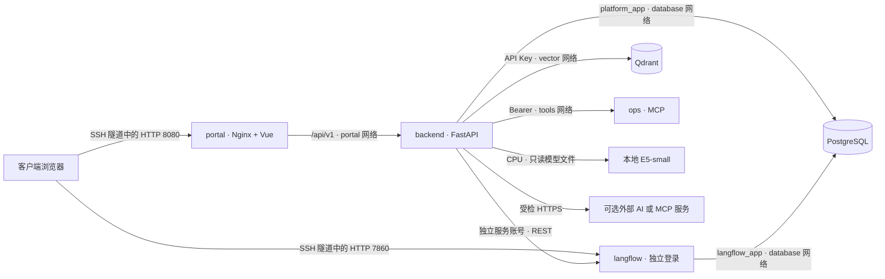
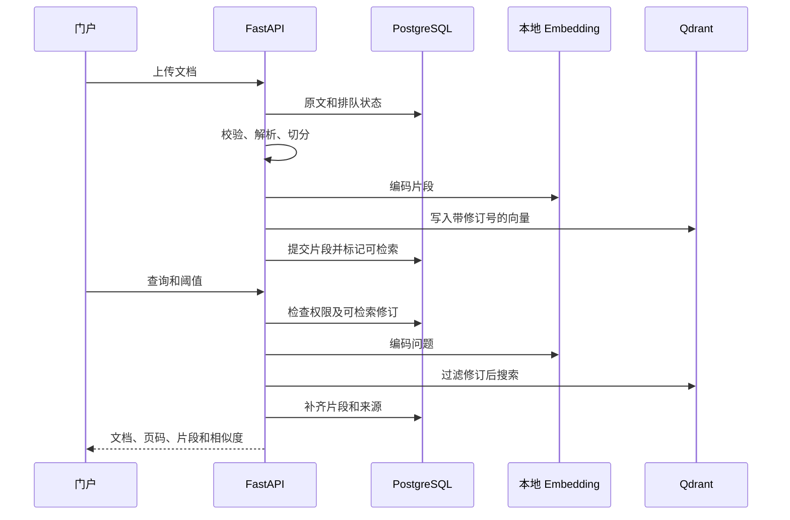

# 项目说明与架构

[文档导航](../README.md) · [部署](DEPLOYMENT.md) · [平台使用与安全](USER-GUIDE.md) · [验收、运维与开发](OPERATIONS.md)

## 01 项目介绍

**目标与完成标准**　理解平台交付范围，区分可复现的实测链路与需要外部条件的能力。本文以业务基线 `31f6d31` 和当期部署检查为依据，阶段记录保留原始时间和证据。

Enterprise AI Agent Platform 是一套单机部署的企业智能体工作台。门户统一管理账号、模型、对话、智能体、工作流、知识库和工具授权。业务 API 管理权限和数据，Langflow 提供可视化编排和受控执行。不同组件独立升级，业务逻辑保留在一个模块化 FastAPI 应用中。

表 01-1　当前能力与状态

| 能力 | 状态 | 事实与边界 |
| --- | --- | --- |
| 门户、登录、账号、会话与权限 | 已实现且已验证 | 浏览器登录、会话撤销、普通用户和开发者越权返回 403、登录限流均已实测 |
| Langflow 编排与文本直通 | 已实现且已验证 | 实机发现、受信图导出回导、同步升版、执行与 SSE 实测通过 |
| 模型管理与对话 | 已实现但部分功能待验证 | 模型配置、凭据加密、失败测试及引擎直通对话已验证。真实云推理仍待验证 |
| 云模型网络 | 已确认问题，尚未解决 | 第三阶段容器中三个官方模型域名解析至 `198.18.0.0/15` 测试网段，触发 SSRF 防护 |
| 知识库和本地 Embedding | 已实现且已验证 | 四种文件解析、真实 E5 向量、引用、Qdrant 重启持久化及向量删除通过 |
| 生成式 RAG 与云端 Embedding | 已实现但部分功能待验证 | 已实现检索上下文组装和模型流程接口，云端 Embedding 与生成式回答需要合规出站和真实凭据 |
| 内置 MCP 与工具审批 | 已实现且已验证 | 六项工具实际使用 MCP Streamable HTTP，参数校验、审批、拒绝和日志均有证据 |
| 外部 MCP 服务 | 已实现但部分功能待验证 | 注册、安全校验与工具策略已实现，真实外部服务接入尚待验证 |
| 应用中心、任务中心及集中审计页面 | 暂未实现 | 导航提供明确待建设页面。后端已有部分结构化事件和调用记录 |
| 独立队列及生产监控 | 后续规划 | Redis、Celery、Prometheus、Grafana 等未包含在当前部署 |

> **待验证：** 文本直通是确定性引擎测试。它说明门户经真实 Langflow 执行并返回 SSE，与产生模型回答的验收是两回事。实际证据见 [阶段记录](PROGRESS.md)。

## 02 架构设计

**目标与完成标准**　能从入口定位 API、数据存储和执行引擎，能说明哪些连接跨越容器网络或外部信任边界。

图 02-1　单机部署拓扑与数据流

### 02.1 组件分工

表 02-1　核心技术与本项目的取舍

| 技术 | 项目中的用途 | 关键取舍 |
| --- | --- | --- |
| Docker Compose | 用 [compose.yaml](../compose.yaml) 声明六个服务、镜像、网络、卷、资源上限和健康检查 | 适合单机复现，容器可单独重建。高可用和跨主机调度属于后续设计 |
| Nginx | [frontend/nginx.conf](../frontend/nginx.conf) 同时服务 Vue 静态文件与代理 `/api/v1`，提供安全响应头、登录限流和流式转发 | 同源访问降低凭据和跨域配置复杂度。当前浏览器至宿主机的加密由 SSH 提供 |
| Vue 3 | TypeScript、Vite、Element Plus、Pinia 和 Vue Router 负责页面、登录状态、导航和交互 | Nginx 读取生产构建产物。前端路由负责体验，API 独立判断权限 |
| FastAPI | 数据校验、身份验证、SQLAlchemy 事务、SSE 和外部适配；Alembic 负责迁移 | Python 生态便于集成模型、解析和 MCP。当前单实例后台文档处理没有分布式调度 |
| PostgreSQL | `platform` 库存用户、会话、配置、业务记录、原文及片段。独立 `langflow` 库存引擎数据 | 关系模型方便检查归属与依赖。两套数据库由独立账号访问，业务代码通过 REST 和引擎通信 |
| Langflow | 原生画布及流程执行。门户通过非管理员服务账号认证并运行受信快照 | 复用现有引擎，当前门户执行限于内置文本直通和模型对话两种受信结构 |
| Qdrant | 每个知识库一个集合，存索引点和文档修订号 | 按修订号过滤向量，按业务库补充文本和权限。备份需要考虑数据库与向量索引一致性 |
| Embedding | 本地量化 ONNX E5-small 将文本转换成 384 维向量。可选云端 OpenAI-compatible 接口 | 本地 CPU 可执行中文和多语检索。知识库记录维度及模型版本，已有集合不能用其他空间的向量直接替代 |
| RAG | 查询向量检索相关片段，再将有限引用组装成模型上下文 | 检索与生成分开验收。模型执行前重新按调用人校验可访问资料 |
| MCP | FastAPI 作为客户端发现和调用工具，`ops` 用真实 Streamable HTTP 提供六项受限运维工具 | 支持参数结构和审批，外部工具没有自动执行入口 |
| RBAC、SSRF 防护 | 角色控制操作，资源归属和共享控制对象访问；外连校验目的地 | 角色与归属是两道检查。对外连接按服务限制地址、解析结果、重定向与凭据流向 |

### 02.2 数据与执行流程

图 02-2　知识检索与引用

普通模型对话从业务数据库读取会话上下文，经过模型适配器请求服务商，再将增量文本转成 SSE。智能体和工作流经 Langflow 执行，门户转译输出和状态。MCP 调用则经过服务共享权限、工具允许列表、参数校验、可选智能体授权和审批，再由 SDK 调用服务。外部服务的工具审批每次必需，内容作为不可信结果展示。

### 02.3 网络与持久化

表 02-2　容器连接与宿主机曝光

| 服务 | 容器监听或连接 | 宿主机入口 | 数据和网络 |
| --- | --- | --- | --- |
| `portal` | `8080/tcp` | `127.0.0.1:8080` | `portal` 网络 |
| `backend` | `8000/tcp` | 无 | `portal`、内部 `database`、`vector`、`tools`；只读挂载 `data/embedding` |
| `postgres` | `5432/tcp` | 无 | 内部 `database`，`postgres_data` |
| `langflow` | `7860/tcp` | `127.0.0.1:7860` | `database`、`outbound`，`langflow_data` |
| `qdrant` | REST `6333/tcp`，gRPC `6334/tcp` | 无 | 内部 `vector`，`qdrant_data` |
| `ops` | `8001/tcp` | 无 | 内部 `tools`，工具仅访问固定平台健康端点 |

> **说明：** `docker compose ps` 的端口列可能显示镜像声明的其他容器端口。只有带宿主机绑定和 `->` 映射的条目是已发布端口，最终以宿主机的 `ss -lnt` 和 Compose 配置为准。
