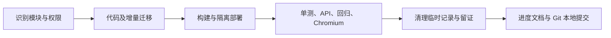

# 验收、运维、故障排查与开发

[文档导航](../README.md) · [项目架构](ARCHITECTURE.md) · [部署](DEPLOYMENT.md) · [平台使用与安全](USER-GUIDE.md)

## 09 测试与日常运维

**目标与完成标准**　理解验收证据的范围，能检查健康与容量，能安排备份、更新和隔离恢复验证。项目执行方负责阶段测试。

### 09.1 验收基线

表 09-1　从代码到部署的验收

| 证据 | 执行方检查 | 通过标准 |
| --- | --- | --- |
| 构建及配置 | Compose、Nginx、TypeScript、Vite 与 Python 依赖一致性 | 配置校验与构建成功 |
| 业务数据库 | Alembic 版本与模型检查，接口中的账号、会话、索引元数据持久化 | 版本为 head，已有数据保留，权限与回归通过 |
| 引擎 | Langflow 连通、原生工作流导入导出、V2 同步、真实直通与 SSE | 可在引擎和业务记录串联同一实测操作 |
| 本地 RAG | 四种文件、库隔离、量化 E5、相关性排序、引用、重启及删除 | 口令问题相关文档首位，索引重启后保留，删文档后关联点清除 |
| MCP | SDK 握手、六个工具、审批、失败记录和真实输出 | 内置工具由真实协议调用，未授权或无效参数无法执行 |
| 浏览器 | 实际 8080 上登录、上传、检索、审批、资源关联、移动导航与深色模式 | 操作成功并留存测试数据截图 |
| 运行状态 | 容器健康、OOM、重启计数、宿主机资源和日志 | 检查时六服务健康，记录采样时点和异常 |

截至第四阶段，两张浏览器截图只含临时数据，实际数据流、测量值和未验证事项见 [PROGRESS.md](PROGRESS.md)。

### 09.2 执行自动化验收

在 Ubuntu 宿主机的项目根目录执行。接口烟雾测试会创建、修改并清理临时记录。使用受控验收实例，不在真实用户操作期间执行。现有脚本读取 `.env` 中的初始门户管理员凭据，若账户已经改密，使用独立验收实例或受控凭据机制，保留当前运营账户。

```bash
docker compose config --quiet
docker compose build backend portal
docker compose exec -T portal nginx -t
docker compose exec -T backend pip check
docker compose exec -T backend alembic current
docker compose exec -T backend alembic check
docker compose exec -T backend python - < tests/test_ai_units.py
docker compose exec -T backend python - < tests/test_knowledge_tools.py
python3 tests/phase3_smoke.py
python3 tests/phase4_smoke.py
python3 tests/phase2_smoke.py
```

`build` 会校验候选镜像，接口测试访问正在运行的容器。正式验收前确认候选镜像已按 09.4 部署。第 2 阶段脚本含限流命中验证，放在最后；若该宿主机刚运行过登录压测，先等待限流恢复。`phase4_smoke.py` 默认保留 Qdrant 运行，附加 `--restart-qdrant` 会实际重启该服务以测试测试集合的持久化，只在隔离验证窗口使用。

浏览器脚本为 [tests/phase4_browser.mjs](../tests/phase4_browser.mjs)。可由受控 Chromium 测试环境运行。以下示例在 Ubuntu 项目根目录使用临时容器，直连实际回环端口。设置中文字体以确保验收截图可读。脚本输出本次 MCP 回执 ID，由外层按该精确 ID 清理已脱离测试服务和智能体的回执，最后保留原测试退出状态。

```bash
set -euo pipefail
mkdir -p /tmp/agent-portal-acceptance
export PLATFORM_ADMIN_USERNAME="$(awk -F= '$1 == "PLATFORM_ADMIN_USERNAME" {print $2}' .env)"
export PLATFORM_ADMIN_PASSWORD="$(awk -F= '$1 == "PLATFORM_ADMIN_PASSWORD" {print $2}' .env)"
export PORTAL_TEST_ORIGIN=http://127.0.0.1:8080
run_log=$(mktemp)
browser_status=0
docker run --rm --network host --cpus 1 --memory 800m \
  --env PLATFORM_ADMIN_USERNAME --env PLATFORM_ADMIN_PASSWORD --env PORTAL_TEST_ORIGIN \
  --env PORTAL_TEST_SCREENSHOTS=/screenshots \
  --volume "$PWD/tests/phase4_browser.mjs:/tmp/phase4_browser.mjs:ro" \
  --volume /tmp/agent-portal-acceptance:/screenshots \
  node:24-bookworm-slim sh -ec '
    apt-get update -qq
    apt-get install -y -qq --no-install-recommends libnss3 libatk1.0-0       libatk-bridge2.0-0 libcups2 libdrm2 libxkbcommon0 libxcomposite1 libxdamage1       libxfixes3 libxrandr2 libgbm1 libasound2 libpango-1.0-0 libcairo2       fonts-liberation fonts-noto-cjk libx11-xcb1 >/dev/null
    cd /tmp
    npm install --no-audit --no-fund --silent playwright-core @sparticuz/chromium
    node /tmp/phase4_browser.mjs
  ' | tee "$run_log" || browser_status=$?
unset PLATFORM_ADMIN_USERNAME PLATFORM_ADMIN_PASSWORD
receipt=$(awk '/^Temporary MCP receipt: / {print $4}' "$run_log")
if [ -n "$receipt" ]; then
  docker compose exec -T backend python - "$receipt" <<'PY'
from sys import argv
from uuid import UUID
from sqlalchemy import delete
from sqlalchemy.orm import Session
from app.db import engine
from app.knowledge_models import ToolCall

with Session(engine) as db:
    result = db.execute(delete(ToolCall).where(
        ToolCall.id == UUID(argv[1]), ToolCall.name == "current_time",
        ToolCall.server_id.is_(None), ToolCall.agent_id.is_(None)
    ))
    if result.rowcount != 1:
        raise SystemExit("Expected one detached test receipt; review test cleanup")
    db.commit()
PY
fi
test "$browser_status" -eq 0
```

> **安全提示：** 上述回执清理命令仅使用这次 Chromium 输出的精确 UUID。断言失败时停下来核对临时资源归属，勿按日期、账号或工具名批量清除。公开留档前人工核对截图中只有合成测试数据。

### 09.3 日常健康与日志

在 Ubuntu 项目根目录执行，以下均为读取：

```bash
docker compose ps
docker stats --no-stream $(docker compose ps -q)
docker inspect --format '{{.Name}} oom={{.State.OOMKilled}} restarts={{.RestartCount}}' $(docker compose ps -q)
free -h
df -h .
uptime
ss -lnt '( sport = :8080 or sport = :7860 or sport = :8000 or sport = :8001 or sport = :5432 or sport = :6333 or sport = :6334 )'
docker compose logs --tail 60 backend portal ops qdrant
```

容器健康应为 `healthy`，OOM 应为 false。与历史比较时同时记录容器启动时间，重建会重置自动重启计数。单次 CPU 采样可能正好落在 ONNX 推理或数据库写入期间，持续高值再调查。阶段四示例快照为宿主机使用 3.0 / 7.7 GiB RAM、磁盘 17%、Swap 780 KiB。Compose 中日志轮转每份 10 MB，最多 3 份。

### 09.4 有计划地重建和升级

仅前端或 Nginx 变动可单独构建并重建 `portal`。后端变动如影响工具共用镜像，安排同时重建 `backend`、`ops`。改动只读取环境变量时通常无需构建，但依然需要用 `up` 更新容器配置。

> **警告：** 重建 API 会终止正在生成的会话与处理中的任务。升级前按下节备份，有迁移时在克隆数据上演练。镜像回退不会撤销已经执行的数据库迁移。

```bash
docker compose config --quiet
docker compose build backend portal
docker compose up -d --no-deps --wait --wait-timeout 120 backend ops portal
docker compose exec -T backend alembic current
docker compose exec -T portal nginx -t
docker compose ps
```

`--no-deps` 假定依赖已经健康，避免在这次变更中意外重启 PostgreSQL 或 Langflow。命令结束后执行相关测试并记录变更和镜像来源。

### 09.5 备份边界与隔离恢复

同时保留 PostgreSQL 的两个库、Langflow 数据卷、Qdrant 快照和 `.env`。原文及片段在 PostgreSQL，向量在 Qdrant；同一恢复批次使用成对备份，避免索引修订号与数据库文档状态错位。本地模型可从固定版本重新安装。

> **待验证：** 已测试持久卷重建及 Qdrant 重启后数据保留。以下备份和全量恢复是根据当前部署拓扑及上游工具给出的推荐操作，尚无完整灾备演练验收记录。

> **警告：** 一致性备份需要维护窗口。先停止写入，确认文档处理、工具调用和模型执行结束，再暂停门户、后端及 Langflow。备份包含秘密和原文，应保存在受限目录并复制到受控备份介质。

在 Ubuntu 项目根目录执行。维护前已有服务正常运行，磁盘可存放数据库和快照副本。

```bash
set -euo pipefail
umask 077
backup_dir="$PWD/backups/$(date +%Y%m%d-%H%M%S)"
mkdir -m 700 -p "$backup_dir"
install -m 600 .env "$backup_dir/deployment.env"
docker compose stop portal backend ops langflow

for database in platform langflow; do
  docker compose exec -T postgres sh -ec '
    PGPASSWORD="$POSTGRES_PASSWORD" pg_dump -h 127.0.0.1 -U postgres -Fc -d "$1"
  ' sh "$database" > "$backup_dir/$database.dump"
  docker compose exec -T postgres pg_restore --list < "$backup_dir/$database.dump" > /dev/null
done
docker compose cp -a langflow:/app/data "$backup_dir/langflow-data"
docker compose run --rm --no-deps -T backend python - > "$backup_dir/qdrant.snapshot" <<'PY'
import os
import sys
from urllib.parse import quote
import httpx

with httpx.Client(base_url="http://qdrant:6333", trust_env=False, timeout=180,
                  headers={"api-key": os.environ["PLATFORM_QDRANT_KEY"]}) as client:
    response = client.post("/snapshots")
    response.raise_for_status()
    name = response.json()["result"]["name"]
    with client.stream("GET", "/snapshots/" + quote(name, safe="")) as response:
        response.raise_for_status()
        for chunk in response.iter_bytes():
            sys.stdout.buffer.write(chunk)
PY
test -s "$backup_dir/qdrant.snapshot"
(
  cd "$backup_dir"
  sha256sum platform.dump langflow.dump qdrant.snapshot > SHA256SUMS
  sha256sum -c SHA256SUMS
)
docker compose up -d --wait --wait-timeout 240
```

`-Fc` 生成 `pg_restore` 可读取的自定义归档。此流程依赖新目标用项目初始化 SQL 创建同名角色。若部署已另外配置角色或授予权限，另用 `pg_dumpall --globals-only` 保存集群级定义，并在恢复前人工检查冲突和敏感信息。失败时保留现有卷，排除错误后按计划恢复服务。等备份校验通过后再将其登记为可恢复批次。快照是额外副本，应按备份保留策略管理，避免占满磁盘。详情见 [PostgreSQL 全局对象备份](https://www.postgresql.org/docs/17/app-pg-dumpall.html) 和 [Qdrant 快照](https://qdrant.tech/documentation/operations/snapshots/)。

恢复演练在**另一台隔离主机**和全新数据卷进行，门户和 Langflow 在导入完成前保持停止。固定镜像版本，从同批次的 `deployment.env` 取必要身份和加密配置，按 [04.2](DEPLOYMENT.md#042-准备源码与配置) 的权限要求保存为 `.env`。先校验备份清单，再只启动 PostgreSQL：

```bash
backup_dir=/绝对路径/受限备份目录
(cd "$backup_dir" && sha256sum -c SHA256SUMS)
docker compose up -d --wait postgres
for database in platform langflow; do
  docker compose exec -T postgres sh -ec '
    PGPASSWORD="$POSTGRES_PASSWORD" pg_restore --exit-on-error -h 127.0.0.1 -U postgres -d "$1"
  ' sh "$database" < "$backup_dir/$database.dump"
done
```

在该隔离实例创建未启动的 Langflow 容器并复制配置文件。保持备份的密钥与数据库相匹配。`-a` 用于保留数值 UID 和 GID，备份介质也需保留这些元数据。

```bash
docker compose create langflow
docker compose cp -a "$backup_dir/langflow-data/." langflow:/app/data
docker compose up -d --wait --wait-timeout 240 langflow
docker compose exec -T langflow sh -ec 'test -w /app/data'
```

> **警告：** Qdrant 快照只恢复到隔离实例的全新 `qdrant_data`。以下清理针对本节命名的恢复用临时容器。确认源部署与目标部署位于不同主机，并且常规 Qdrant 服务尚未占用目标卷，再启动恢复。

```bash
docker compose run -d --no-deps --name agent-platform-qdrant-restore \
  --volume "$backup_dir/qdrant.snapshot:/restore/qdrant.snapshot:ro" \
  --entrypoint /qdrant/qdrant qdrant --storage-snapshot /restore/qdrant.snapshot
docker logs --tail 50 agent-platform-qdrant-restore
docker inspect --format '{{.State.Health.Status}}' agent-platform-qdrant-restore
```

等临时容器显示 `healthy` 且日志无恢复错误后，停止并移除该临时容器，保留命名卷。再用标准 Compose 配置启动服务。

```bash
docker stop agent-platform-qdrant-restore
docker rm agent-platform-qdrant-restore
python3 scripts/provision_phase4.py
docker compose build backend portal
docker compose up -d --wait --wait-timeout 240
docker compose exec -T backend alembic current
docker compose ps
```

隔离实例的应用启动后，验证登录、文档下载、向量点数、查询引用和 MCP 权限。恢复演练成功后再制定生产切换计划。

## 10 故障排查

**目标与完成标准**　从故障现象缩小范围，保存证据并按对应条目验证修复。除说明为客户端的命令外，以下命令均在 Ubuntu 项目根目录运行。

### 10.1 Docker 或 SSH 入口不可用

| 项目 | 处理 |
| --- | --- |
| 故障现象与影响 | `docker version` 只有客户端，或浏览器本地端口无法连接。影响部署管理或门户入口 |
| 可能原因 | Docker daemon 未启动、socket 权限、宿主机监听错误、SSH 转发失败或客户端端口占用 |
| 排查顺序与结果 | 宿主机先检查 daemon 和回环监听，再测试同机 HTTP。宿主机 HTTP 成功而客户端失败时检查 SSH 输出和客户端端口 |
| 解决、验证与状态 | 使用受信运维权限启动 daemon 或按授权修正隧道，保持回环绑定。两个入口经客户端隧道已由用户确认通过；本条也供新环境排障 |

```bash
systemctl is-active docker
docker version
docker compose ps
ss -lnt '( sport = :8080 or sport = :7860 )'
curl -fsS http://127.0.0.1:8080/api/v1/health
curl -fsS http://127.0.0.1:7860/health
```

客户端可增加 `-v` 重跑 [SSH 命令](DEPLOYMENT.md#052-从客户端访问) 查看转发错误。若提示本地端口已占用，只调整 `-L` 左侧。Ubuntu 的 HTTP 健康请求应返回 200。

### 10.2 PostgreSQL 或迁移失败

| 项目 | 处理 |
| --- | --- |
| 故障现象与影响 | API 无法就绪，`alembic` 报连接、权限或结构错误。影响业务数据操作 |
| 可能原因 | PostgreSQL 尚未健康、连接账户失配、迁移依赖或版本错误 |
| 排查顺序与结果 | 先看数据库健康，再读后端启动日志，最后验证当前迁移与模型差异。若仅重启后仍旧使用原密码，核对已有 PostgreSQL 角色和配置是否同步 |
| 解决、验证与状态 | 修正迁移或角色配置，备份并重建后端。阶段三 JSONB 缺失导入导致启动失败，已修复并验证。目标为 `0003_knowledge_tools (head)`，`alembic check` 无差异 |

```bash
docker compose ps postgres backend
docker compose logs --tail 60 backend postgres
docker compose exec -T postgres pg_isready -h 127.0.0.1 -U postgres -d postgres
docker compose exec -T backend alembic current
docker compose exec -T backend alembic check
```

> **警告：** 旧卷不重新执行初始化 SQL。不要清空 PostgreSQL 卷或通过伪造迁移版本跳过错误。保留备份，在隔离副本上验证修复。

### 10.3 Langflow 健康但执行失败

| 项目 | 处理 |
| --- | --- |
| 故障现象与影响 | 原生页正常，但门户报引擎认证失败、流程不可运行或 SSE 无结果 |
| 可能原因 | 服务账号无对应访问权、私有图被改动且未同步、端点版本或事件格式差异、原生数据目录权限异常 |
| 排查顺序与结果 | 检查健康和容器日志，确认 `/app/data` 可写，再通过门户运行受信文本直通。若直通成功而模型流程失败，转到 10.4 |
| 解决、验证与状态 | 使用独立服务账号和受信图，重新同步后看执行状态。早期目录写入问题已改用 `/app/data` 修复，SSE 结束事件与认证会话问题已修复。原签名密钥格式导致 API Key 签发失败，当前以 Bearer 会话工作 |

```bash
curl -fsS http://127.0.0.1:7860/health
docker compose exec -T langflow sh -ec 'test -w /app/data && ls -ld /app/data'
docker compose logs --tail 80 langflow backend
```

现有实例遇到签发问题时保留签名密钥，先确认门户服务账号路径。需要轮换时查看 [04.2 配置要求](DEPLOYMENT.md#042-准备源码与配置) 并单独评估，不能从健康状态推断凭据已可用。

### 10.4 云模型连接报目的地受限

| 项目 | 处理 |
| --- | --- |
| 故障现象与影响 | 云端模型连接测试或生成报目的地受限。影响云推理、模型工作流及生成式 RAG |
| 已有证据及可能原因 | 第三阶段测得 OpenAI、DeepSeek、Qwen 官方域名映射到 `198.18.0.0/15`。在后来网络环境中仍应以实际结果判断 |
| 排查顺序与结果 | 先从工具错误区分 DNS、HTTP 认证和超时，再由网络运维在获准条件下核对容器所在网络的解析和出站路径 |
| 解决、验证与状态 | 由网络运维提供与 SSRF 策略相容的合规出站。恢复后先验证公开目的地，再用有效凭据验证模型连接和 SSE，最后验收生成式 RAG。当前为已确认问题，尚未解决 |

下例用于**获准进行验证的环境**，只做 DNS 查询，未包含真实模型调用：

```bash
docker compose exec -T backend python - <<'PY'
import socket
from app.provider import public_ip
for host in ("api.openai.com", "api.deepseek.com", "dashscope.aliyuncs.com"):
    try:
        addresses = sorted({entry[4][0] for entry in socket.getaddrinfo(host, 443, type=socket.SOCK_STREAM)})
        print(host, [(address, public_ip(address)) for address in addresses])
    except OSError as error:
        print(host, type(error).__name__)
PY
```

> **重要：** 所有候选地址都应符合策略。有受限地址时保留拦截。HTTP 401/403 说明连通性与密钥授权需分别判断。域名解析成功不代表模型推理已通过。

### 10.5 文档失败、检索为空或 Qdrant 不健康

| 项目 | 处理 |
| --- | --- |
| 故障现象与影响 | 文档失败或一直处理，或者搜索无匹配。影响单文档或知识库 |
| 可能原因 | 文件签名错误、扫描件、模型文件不齐、服务重启、Qdrant 认证或权限问题、阈值过高 |
| 排查顺序与结果 | 先看文档状态和失败原因，再确认可读片段及查询阈值。服务侧查 Qdrant 健康、模型文件校验、库是否启用及调用人权限 |
| 解决、验证与状态 | 用正确格式或 OCR 后的文件，按配置重新索引，降低异常过高的相似度阈值时记录选择依据。阶段四验证了坏签名拒绝、重处理、重启持久化、关联向量删除 |

```bash
docker compose ps qdrant backend
docker compose logs --tail 60 qdrant backend
ls -lh data/embedding
python3 scripts/provision_phase4.py
```

最后一条命令可能下载缺失文件，只在需要重建本地权重时执行。预期校验通过。若需重启，使正在处理的文档先结束。入库成功后用包含干扰文档的独立样本检查排序和来源。

### 10.6 MCP、权限与限流异常

| 项目 | 处理 |
| --- | --- |
| 故障现象与影响 | 管理操作返回 403、资源返回 404、调用停在待审批、工具结果失败或登录返回 429 |
| 可能原因 | 角色或归属无权限、工具未授权、智能体关联缺失、参数不符、连接或结构变化、短时多次登录 |
| 排查顺序与结果 | 先确认账号角色及服务启用。检查工具允许列表、智能体资源和调用记录。再看内置工具健康及网关或后端日志 |
| 解决、验证与状态 | 经授权的管理员调整工具批准范围，使用合规 JSON 重试一次。429 等待限流窗口恢复。内置调用及审批结果已实测；外部 MCP 的联机接入仍待验证 |

```bash
docker compose ps ops portal backend
docker compose logs --tail 60 ops backend portal
docker compose exec -T ops python -c 'from urllib.request import urlopen; print(urlopen("http://127.0.0.1:8001/health", timeout=3).status)'
```

内置健康返回 200 只说明服务可用。工具调试实际审批后收到结构化 `datetime`，才能证明时间工具调用成功。测试中的策略拒绝和调用失败均是独立检查项。

## 11 二次开发与技术交接

**目标与完成标准**　能定位变更涉及的模块，以迁移、接口、前端和验证形成完整改动。

| 路径 | 用途 |
| --- | --- |
| [backend/app](../backend/app) | 路由、访问权限、模型和 Langflow 适配、文档处理、向量和 MCP |
| [backend/migrations](../backend/migrations) | Alembic 环境和版本链 |
| [frontend/src](../frontend/src) | Vue 路由、同源 API 客户端、业务页及组件 |
| [scripts](../scripts) | Langflow 服务身份、ONNX 安装和样例配置 |
| [tests](../tests) | 单测、各阶段 API 烟雾、实机浏览器测试 |
| [AGENTS.md](../AGENTS.md) | 项目约束、变更及自主验收责任 |

推荐流程是在独立验收实例实现变更，然后依次验证数据迁移、失败和越权路径、页面、部署以及历史功能。新增持久字段时在 `backend/migrations/versions` 新建 Alembic 版本，保留旧版本链。新增路由以 FastAPI 服务端鉴权为准，前端使用现有 API 封装及同源路由。外部客户端复用现有 SSRF 规则。变更结束后保存不含秘密的证据，更新 `docs/PROGRESS.md`，执行本地 Git 提交。

### 11.1 接口开发和迁移审查

开发者先阅读 [后端路由](../backend/app/main.py) 与 [前端请求封装](../frontend/src/api.ts)。当前入口停用了自动文档页面。以 `/api/v1/health` 作为无凭据连接检查，测试业务接口时在独立实例使用测试账号和 Cookie，写操作带 `X-Platform-Request: 1`，按业务限制处理 JSON 或 multipart。测试 401 时不送 Cookie；测试 403 时使用有效但权限不足的角色。

变更模型后，在 Ubuntu 项目根目录对已迁移到当前 head 的**开发数据库**生成候选迁移。以下示例把当前工作区的后端挂载到临时容器，因此新文件会写回 `backend/migrations/versions`。需要先确保开发实例的 `postgres` 已健康。

```bash
docker compose run --rm --no-deps --user "$(id -u):$(id -g)" \
  --volume "$PWD/backend:/source" backend sh -ec '
    cd /source
    alembic revision --autogenerate -m "describe the schema change"
  '
git status --short backend/migrations/versions
```

将示例消息替换为说明改动的文本，检查 `down_revision`、PG 类型导入、索引、约束和有数据表的兼容性。生成后先在隔离副本应用，再确认升级后仍可登录、旧数据可读、最新模型无遗漏迁移。历史版本中出现过 JSONB 导入遗漏，因此需要审查和运行候选脚本。

### 11.2 交付与答辩

图 11-1　可追溯交付流程



项目交接或展示可依次讲解图 02-1 的部署边界、图 02-2 的检索闭环、图 07-1 和图 07-2 的真实证据，最后用表 01-1 说明限制和后续规划。对于云模型演示，应先取得真实授权并完成连通验证。
