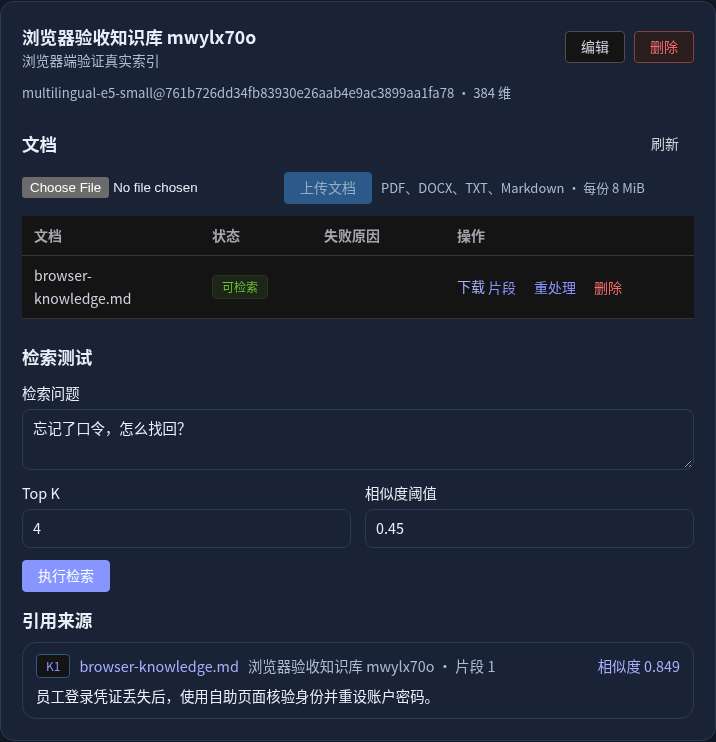
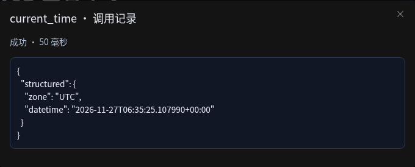

# 平台使用与安全设计

[文档导航](../README.md) · [项目架构](ARCHITECTURE.md) · [环境部署](DEPLOYMENT.md) · [验收与运维](OPERATIONS.md)

## 06 功能实现与数据边界

**目标与完成标准**　理解各功能入口实际调用的后端，以及界面显示和后台状态之间的关系。

| 功能入口 | 后端与状态流转 | 主要存储 |
| --- | --- | --- |
| 登录、个人设置、用户与权限 | `/auth`、`/users`。登录创建可撤销会话，停用或改密使旧会话失效 | 用户、密码哈希、会话记录 |
| 模型管理、AI 对话 | `/models`、`/conversations`。可选已启用模型或智能体，生成状态通过 SSE 更新 | 加密配置、对话、消息、执行摘要 |
| 智能体管理、工作流 | `/agents`、`/workflows`。关联、发布、同步和运行由业务 API 检查权限 | 智能体、授权关系、图快照及执行历史 |
| 知识库管理 | `/knowledge`。文档经排队、处理，最终可检索或失败 | PostgreSQL 原文、片段及状态，Qdrant 向量和修订号 |
| MCP 工具中心 | `/mcp`。发现、授权、调用申请和审核；结果记录成功、失败或拒绝 | 服务配置、工具结构和审批调用记录 |
| 工作台、系统监控 | 展示后端实际报告的基础健康状态 | 当前健康查询及角色范围内的账号统计 |

表 06-1　功能入口与后端责任。以上路径均以 `/api/v1` 为前缀。应用中心、任务中心和集中审计页面属于 [当前范围说明](ARCHITECTURE.md#01-项目介绍) 中的待建设功能。

## 07 平台使用

**目标与完成标准**　按角色完成所需业务操作，能识别成功、失败和等待状态。以下为产品使用指引，项目阶段验收由执行方通过自动化完成。

### 07.1 登录、个人设置与用户管理

在客户端建立 [SSH 隧道](DEPLOYMENT.md#052-从客户端访问)，访问门户。首次部署的默认用户名为 `portal_admin`，初始口令由部署者在宿主机受限的 `.env` 中管理，配置项为 `PLATFORM_ADMIN_PASSWORD`。登录后从右上角进入「个人设置」可改密或退出。管理员在「用户与权限」创建、编辑、启停账号并设定角色。普通用户操作以自己账号为准。

> **安全提示：** 门户账户与原生 Langflow 账户分别管理。门户的开发者角色允许看到编排入口，还需独立的 Langflow 身份及相应原生权限。把门户初始密码放入受信凭据渠道，通过用户管理界面变更已有账户。

正常登录进入工作台，并能看到与角色匹配的导航。登录错误、429 或权限不足见 [故障排查](OPERATIONS.md#10-故障排查)。

### 07.2 模型管理与对话

以门户管理员打开「模型管理」，新建模型，填写显示名、服务商、模型标识和 API Key。模型标识必须与服务商授权一致。启用后可设为默认。只有真实连接测试成功的配置才应作为业务默认模型。界面显示是否已配置密钥、调用时间、耗时和服务商实际返回的 Token。

表 07-1　模型连接配置

| 服务商 | 本项目地址 | 用途 |
| --- | --- | --- |
| OpenAI | `https://api.openai.com/v1` | 普通对话和受信 Langflow 模型模板 |
| DeepSeek | `https://api.deepseek.com/v1` | 普通对话和受信 Langflow 模型模板 |
| Qwen | `https://dashscope.aliyuncs.com/compatible-mode/v1` | 普通对话 |
| 自定义 | 服务商提供的公网 HTTPS 443 Base URL | 普通对话，路径应为 API 根路径，由适配器追加 `/chat/completions` |

编辑时保留已有密钥可留空该字段，更换 Base URL 时须重新填写或清除密钥。温度、最大输出 Token 和超时应遵循服务商模型限制。连接测试会发起模型请求，使用真实凭据时可能计费。

打开「AI 对话」，新建会话，选择「模型对话」或「智能体对话」，选择具体资源，填写消息后发送。成功时可看到流式文本、历史消息和 Markdown。会话可以重命名或删除。主动停止或生成失败后可按界面提示重试。只有成功生成的助手消息会作为正常回答写入会话。

> **待验证：** 当前实测为模型配置、失败诊断和确定性流程对话。云端模型出站曾被 Fake-IP 触发的安全策略拦截。连接测试失败时见 [10.4](OPERATIONS.md#104-云模型连接报目的地受限)。

### 07.3 工作流与智能体

开发者或管理员进入「工作流管理」。

1. 选择「新增或导入」，测试引擎时用「文本直通」。需要生成式回答时用「模型对话」并配置 OpenAI 或 DeepSeek 模型。导入文件必须符合受信模板。
2. 在「详情与执行」输入测试文本，查看输出与耗时。文本直通预期回传输入文本，可用于隔离引擎连通问题。需要编辑画布时打开独立 Langflow。
3. 原生修改后回到门户执行「同步」。仅允许受信结构，合格的布局变化可形成下一版本。若服务账号不可读或图结构不被批准，界面报告失败。导出为受信图及元数据。

随后进入「智能体管理」，创建或编辑智能体，填写名称、说明和系统提示词，关联已获权限的工作流。模型模板可选择启用的支持模型。使用「调试与历史」确认运行，完成后再发布。发布的智能体对其他登录用户可用，但用户对知识库和工具的原有权限继续生效。当前预置「企业 IT 智能运维助手」为草稿。

### 07.4 知识库、检索与引用

在「知识库管理」用具有写权限的账号执行：

1. 新建知识库，选择「本地多语言 E5-small」，设置分段长度、重叠、Top K 和阈值。Top K 是最大返回片段数。阈值使用余弦相似度，过高会使结果为空。需要其他用户读取时明确启用共享。
2. 上传 PDF、DOCX、TXT 或 Markdown。单份上限 8 MiB，文本须用 UTF-8。界面经历「排队」「处理中」「可检索」或「失败」。扫描 PDF 需预先 OCR，失败原因在文档行展示。
3. 通过「片段」核对解析内容，使用「检索测试」输入问题，查看相似度、原文文档、页码和片段号。点击引用进入原文下载。若问题换词后仍能检出相关片段，可结合干扰文档验证排序。
4. 如需调整已索引文档的切分，在编辑知识库后对该文档「重处理」。重新索引期间该文档旧修订不参与搜索。

> **警告：** 删除文档会清理原文与关联向量，删除知识库覆盖其全部文档。确认范围并保存需留存的原件或备份，再执行删除。已关联知识库需先解除关联。

*图 07-1　Chromium 实测的知识库检索、片段来源与相似度。画面仅含临时测试文档。*

在「智能体管理」打开「关联资源」，选中有权使用的知识库。可在智能体调试面板使用「检索知识」预览授权范围内的片段，独立于生成模型。「模型对话」工作流也可选择一个可读知识库。生成式回答将引用作为上下文，当前实测结果只覆盖本地检索与上下文预览。

### 07.5 MCP 调试、授权和审批

当前部署已登记私有「企业运维工具」。新实例在「MCP 工具中心」由管理员选择「注册服务」，选择内置类型并保存。打开「连接测试与发现」，成功后在「编辑」勾选允许调用的工具。若要供其他登录用户使用，明确开启共享并保留审批。

1. 选中服务，打开工具行「参数与调试」。先按窗口显示的结构填写 JSON 对象。例如 `current_time` 使用 `{"zone":"UTC"}`。
2. 内置服务默认提交审批。管理员在「调用和审批记录」审查参数，再选择「批准并执行」或拒绝。成功后显示实际输出和耗时。失败时显示安全化的错误状态。
3. 在「智能体管理」关联服务内的具体工具。随后在 MCP 页面选择智能体为调用身份，范围会进一步收窄。仅模型流程支持将调用人自己的已批准成功结果作为上下文引用。

*图 07-2　Chromium 实测的 MCP 批准执行结果，包含 UTC 返回时间与调用耗时。*

> **安全提示：** 外部服务须由管理员登记公网 HTTPS Streamable HTTP 地址，并在发现后显式授权工具。外部调用每次必须审批，审批前校验范围和参数，实际调用还会检查工具结构。内置联网检查只接受固定的 `platform_api` 目标。网络计算只计算 CIDR，资源指标来自运维容器。

## 08 安全设计

**目标与完成标准**　能区分角色授权、资源归属和网络出站策略，按对应边界诊断权限错误。

表 08-1　门户权限矩阵

| 操作 | 管理员 | 开发者 | 普通用户 |
| --- | --- | --- | --- |
| 自己的会话和设置 | 允许 | 允许 | 允许 |
| 用户管理及模型配置 | 允许 | 拒绝 | 拒绝 |
| 智能体 | 可管理；调用仍校验状态 | 管理自己创建的智能体；可使用已发布智能体 | 可使用已发布且启用的智能体 |
| 工作流与原生入口 | 可管理；原生权限另行校验 | 管理自己的流程；原生权限另行校验 | 不能从门户管理工作流 |
| 知识库 | 可管理 | 管理自己创建的库，可读取启用的共享库 | 读取启用的共享库 |
| MCP 服务配置、授权与审批 | 管理及审批 | 可使用已授权的共享工具并关联有权使用的资源 | 可使用已授权的共享工具，具备相应智能体权限时可按该身份调用 |

### 08.1 身份与凭据

门户密码使用 Argon2 哈希。登录签发 30 分钟 JWT，保存在 HttpOnly、SameSite Strict Cookie 中，并由服务端记录可撤销会话。Nginx 针对登录路径限流，业务写请求使用同源流程与 `X-Platform-Request: 1` 标记。管理员角色也受会话所有权和执行资源条件约束。模型和外部 MCP 密钥在数据库内经 Fernet 加密，响应只给配置状态。

### 08.2 SSRF 与资源授权

自定义模型、云端 Embedding 和外部 MCP 使用受检 HTTPS 地址。适配器拒绝私有、保留及其他非允许地址，校验解析结果，并把直连固定到通过校验的地址，同时使用原域名完成 TLS 校验。外链不能通过重定向改变目标。少量固定内部地址属于独立内置配置。Langflow 模型路径仅支持项目认可的服务商，并在执行前检查目标。业务层不把任意图、自定义参数或任意连接器提交为可运行工作流。

> **重要：** Fake-IP 命中拦截是当前已确认的网络与应用边界冲突。有效的模型密钥不会改变地址校验结果。应走获准网络出口解决，保留现有 SSRF 策略。

### 08.3 文件、工具及日志边界

原文下载和片段均经业务权限判断。DOCX 只读取正文 XML，限制解包大小并禁止外部实体。模型上下文与工具响应一律作为资料，工具权限不受模型回复或外部结果影响。服务使用结构化安全记录和日志轮转。收集日志前先筛查凭据与业务内容，审核记录按权限共享。
